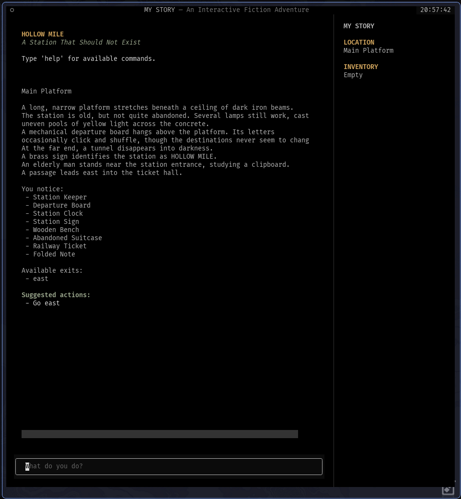

# HOLLOW MILE

**A reusable, data-driven interactive-fiction engine built with Python.**

HOLLOW MILE is a framework for creating text-based adventures and narrative-driven games. It separates the game engine from story content, allowing you to build multiple games using YAML files without rewriting the underlying engine.

## Showcase

HOLLOW MILE includes a playable showcase game, also named HOLLOW MILE, built using the engine itself.



*The HOLLOW MILE showcase game running in the terminal interface.*

## Features

- YAML-defined stories, locations, entities, and dialogue
- Location navigation and conditional exits
- Entity inspection, interaction, and inventory management
- Branching dialogue with conditional choices
- Puzzles and item-based interactions
- Game state using flags and variables
- Configurable terminal interface
- CLI tools for creating, validating, and running projects

## Installation

### Download a release

Download the latest release from the [GitHub Releases page](../../releases).

Extract the downloaded archive. If it includes the standalone executable, you can run `hollow-mile-cli.exe` from a terminal.

To play the showcase game, make sure the `hollow-mile` game folder is included alongside the executable.

### Run from source

Clone the repository:

```bash
git clone <repository-url>
cd hollow-mile
```

Install the project:

```bash
python -m pip install -e .
```

## Running the showcase game

The repository includes a playable game named **HOLLOW MILE**, built using the engine itself (you need to download the release with the showcase to get it).

Validate the game:

```bash
hollow-mile validate hollow-mile
```

Run it:

```bash
hollow-mile run hollow-mile
```

The showcase game demonstrates the engine's features and provides an example of how a complete game can be defined using YAML files.

You can inspect its files to see how locations, entities, dialogue, puzzles, and interactions are structured.

## Creating your own game

Create a new project:

```bash
hollow-mile init my-game
```

Validate it:

```bash
hollow-mile validate my-game
```

Run it:

```bash
hollow-mile run my-game
```

Your game content is stored separately from the engine, allowing you to create multiple independent games using the same installation.

## Project structure

```text
hollow-mile/
├── docs/
│   ├── showcase.png
│   └── YAML_REFERENCE.md
├── hollow-mile/
│   ├── story.yaml
│   ├── config.yaml
│   ├── locations/
│   ├── entities/
│   └── dialogue/
├── src/
│   └── engine/
├── README.md
├── pyproject.toml
├── build.bat
└── build.py
```

A typical game project contains:

```text
my-game/
├── story.yaml
├── config.yaml
├── locations/
│   ├── index.yaml
│   └── ...
├── entities/
│   ├── index.yaml
│   └── ...
└── dialogue/
    ├── index.yaml
    └── ...
```

See [YAML Reference](docs/YAML_REFERENCE.md) for details about defining game content.

## Building the executable

On Windows, run:

```bat
build.bat
```

The executable will be generated at:

```text
dist/hollow-mile.exe
```

## Requirements

- Python 3.12+
- Textual
- PyYAML

## Project status

HOLLOW MILE is (was, just for Terra) under active development. Features and file formats may change between releases.

## License

See the `LICENSE` file for licensing information.